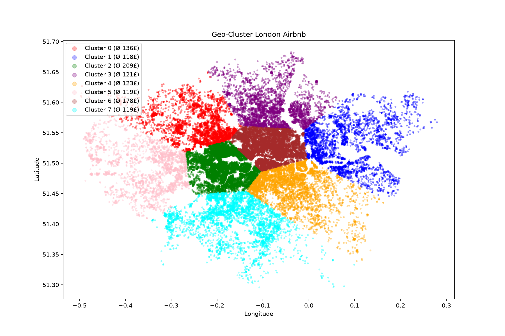
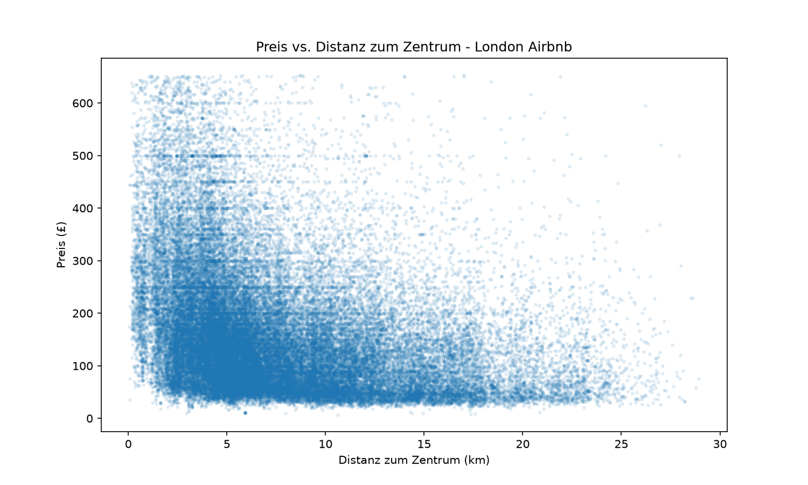
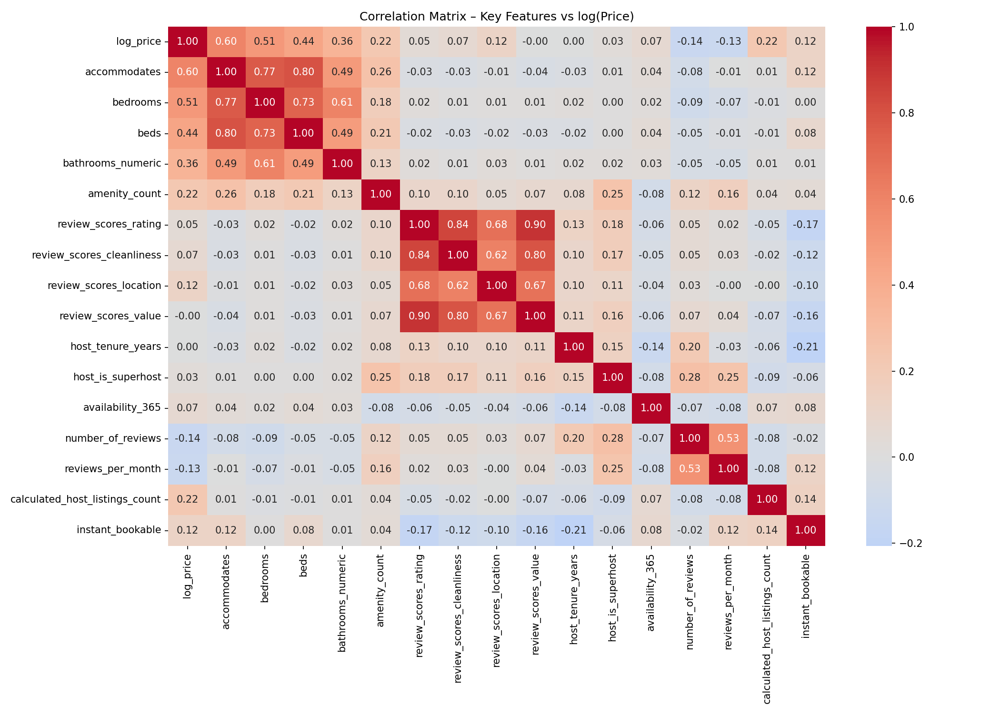
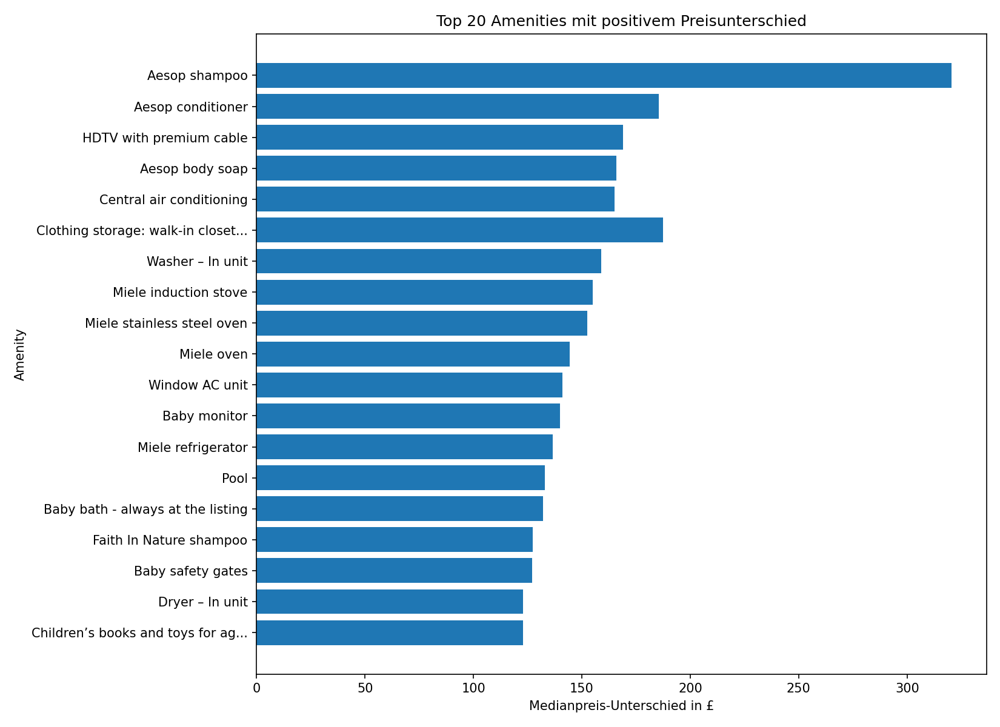
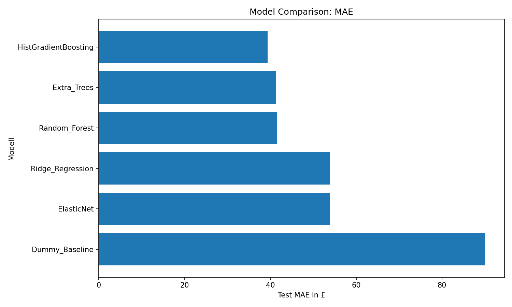
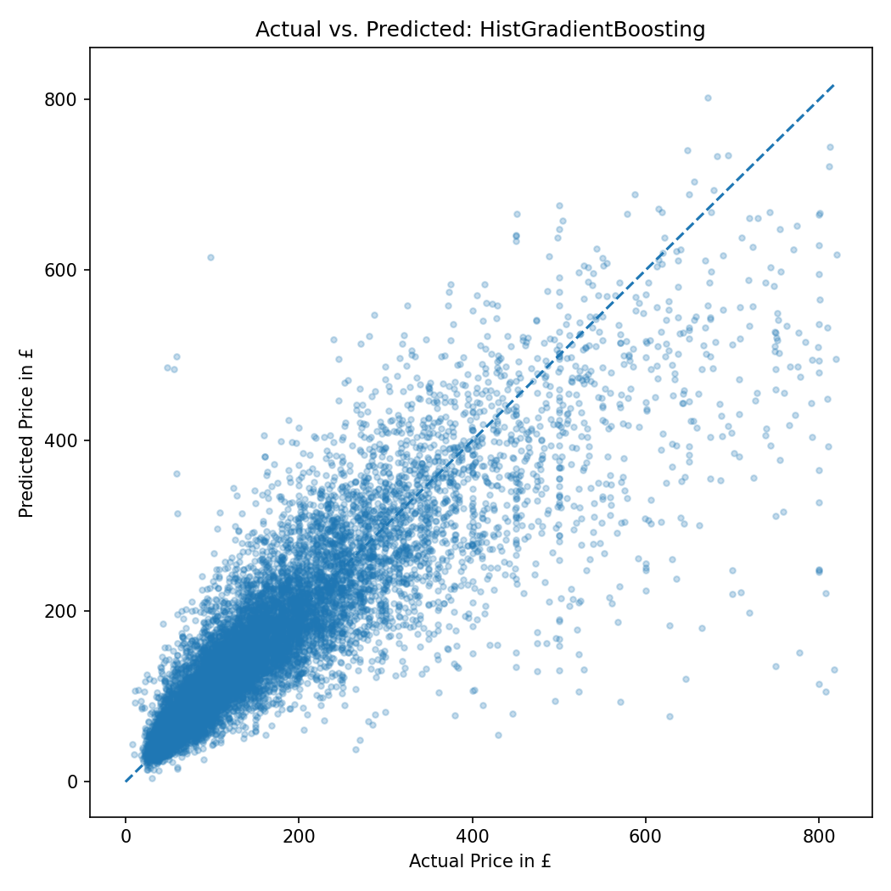
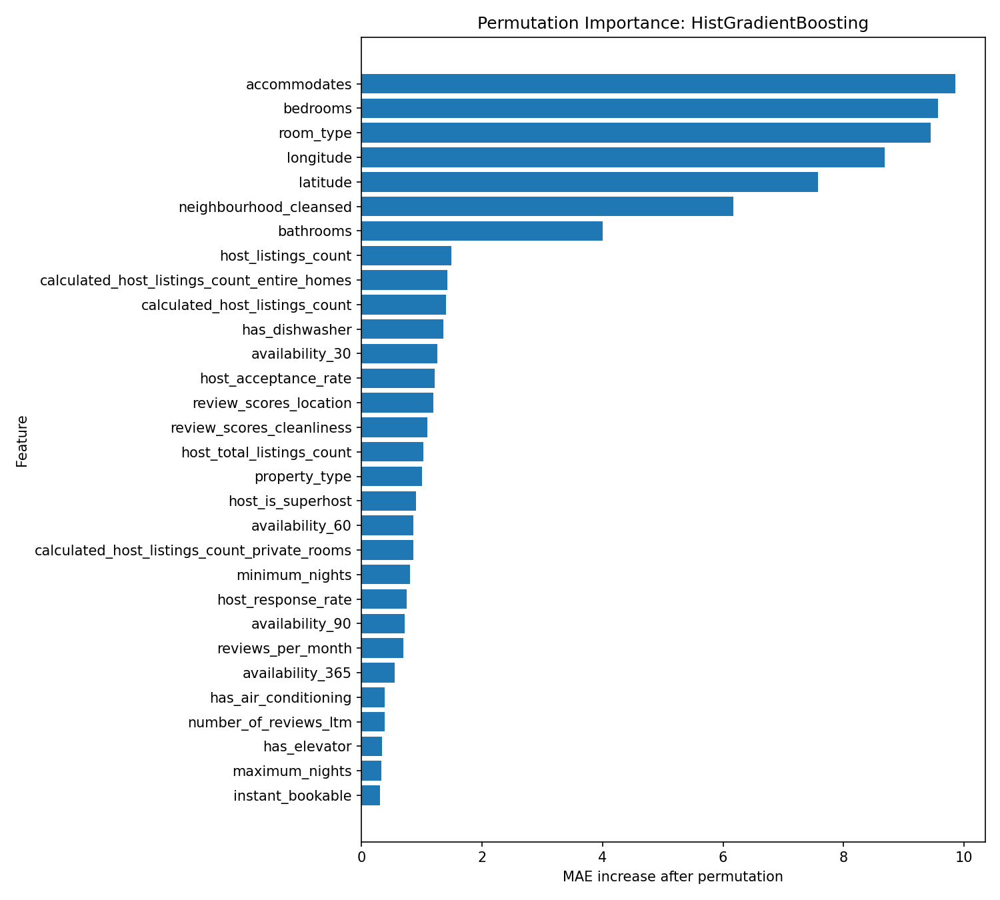

# Airbnb London — Nightly Price Prediction & Interactive App

[](https://www.python.org/)
[](https://scikit-learn.org/)
[](https://streamlit.io/)
[](https://git-lfs.github.com/)
[](LICENSE)
[](https://www.kit.edu/)

An end-to-end Machine Learning case study developed for **Data Science for Business** (Karlsruhe Institute of Technology, 1st Semester). The objective is to analyze listing dynamics in London, predict nightly Airbnb rates from property characteristics, and deploy the winning predictive model as an interactive web tool.

---

## Executive Summary & Key Results

- **Business Objective**: Predict nightly Airbnb prices in London, identify major price drivers, and quantify uncertainty for host price recommendations.
- **Data Scale**: 60,000+ listings from [Inside Airbnb](http://insideairbnb.com/) with over 65 engineered features across location, room basics, reviews, availability, and amenities.
- **Winning Model**: **Histogram-based Gradient Boosting Regressor (`HistGradientBoosting`)**
  - **Test MAE**: **£39.37**
  - **Test RMSE**: **£65.28**
  - **Test $R^2$**: **0.746** (74.6% of price variance explained)
- **Deployment**: Interactive **Streamlit application** (`app/price_predictor_app.py`) providing instantaneous price forecasts accompanied by a local **90% empirical prediction interval**.

---

## Visual Highlights

### 1. Geospatial & Exploratory Insights
Listing prices in London are strongly driven by geographic proximity to central landmarks and borough clusters:

| Spatial Clustering (K-Means) | Price Decay vs. Distance to Center |
|:---:|:---:|
|  |  |

Listing characteristics exhibit distinct correlation patterns with price:
<p align="center">
  
</p>

---

### 2. High-Impact Amenity Valuation
Dimensionality reduction on over 100 free-text amenities identified high-premium features (e.g. premium body care, central AC, private hot tubs) versus standard baseline amenities:

<p align="center">
  
</p>

---

### 3. Model Benchmark & Evaluation
Six algorithm families (Dummy Baseline, Ridge, ElasticNet, Random Forest, Extra Trees, HistGradientBoosting) were evaluated across multiple feature sets with 5-fold cross-validation and hyperparameter tuning:

| Mean Absolute Error across Models | Actual vs. Predicted (Test Set) |
|:---:|:---:|
|  |  |

#### Permutation Feature Importance
Permutation importance highlights the dominant role of accommodation capacity (`accommodates`), bedroom count (`bedrooms`), room type (`Entire home/apt`), and geographic coordinates (`latitude`, `longitude`):

<p align="center">
  
</p>

---

## Model Performance Benchmark

| Iteration | Feature Set | Best Model | Test MAE | Test RMSE | Test $R^2$ |
|---|---|---|---|---|---|
| Phase 1 Baseline | Linear/Ridge baseline on bedroom & type | Ridge Regressor | ~£58.00 | ~£96.00 | 0.520 |
| Run 1 | Core Predictor + Amenities (31 features) | Random Forest | £49.14 | £80.28 | 0.616 |
| **Run 2 (Final)** | **Predictor + Amenities + Categorical Features (65 features)** | **HistGradientBoosting** | **£39.37** | **£65.28** | **0.746** |

---

## Quickstart & Installation

### Prerequisites
- Python 3.10+
- [Git LFS](https://git-lfs.com/) installed on your machine (`brew install git-lfs` or `apt-get install git-lfs`)

### 1. Clone the Repository with Git LFS
```bash
git lfs install
git clone https://github.com/Ludwig-Sc/airbnb-london-price-predictor.git
cd airbnb-london-price-predictor
```

### 2. Install Dependencies
```bash
python -m venv venv
source venv/bin/activate  # On Windows: venv\Scripts\activate
pip install -r requirements.txt
```

### 3. Launch the Interactive Price Predictor App
```bash
streamlit run app/price_predictor_app.py
```
The application will launch in your browser at `http://localhost:8501`.

---

## The Streamlit Application

The interactive web tool allows prospective hosts and property managers to test custom configurations:
- **Location Selector**: Choosing a London borough auto-populates median coordinates (with manual latitude/longitude override).
- **Listing Attributes**: Room type, property type, accommodates, bedrooms, beds, and bathrooms.
- **Host & Review Settings**: Superhost status, review scores rating, minimum nights.
- **Grouped Amenities Checklist**: Direct toggles for high-impact amenities (WiFi, kitchen, dishwasher, washer, workspace, AC, etc.).
- **Uncertainty Quantification**: In addition to point estimates, the app calculates an empirical **90% prediction interval** computed from the residuals of the nearest 1,000 historical test predictions.

---

## Pipeline Architecture

All modular scripts are located in `scripts/` and can be executed sequentially from the project root:

```text
Raw Data (Inside Airbnb)
       │
       ▼
[01_clean_data.py] ──────────► Cleaned listings, booleans & formatted values
       │
       ▼
[02_create_categories.py] ───► Split into 9 topical datasets (Price, Location, Host...)
       │
       ▼
[04_build_predictor.py] ─────► Predictor dataset with IDs & engineered bedroom features
       │
       ▼
[06_geo_analysis.py] ────────► Distance to center, K-Means clustering, Folium maps
       │
       ▼
[07_amenities_price.py] ─────► Amenity parsing, frequency analysis & value impact
       │
       ▼
[08_compare_models.py] ──────► 6 Models CV & grid search, feature importance, saved .joblib
       │
       ▼
[app/price_predictor_app.py] ─► Deployed interactive Streamlit application
```

| Step | Script | Description |
|---|---|---|
| `01` | `01_clean_data.py` | Normalizes types, converts booleans, parses price strings, cleans missing values. |
| `02` | `02_create_categories.py` | Partitions cleaned listings into 9 functional sub-tables (`price`, `location`, `host`, etc.). |
| `03` | `03_aggregate_reviews_calendar.py` | Aggregates daily calendar occupancy and review histories per listing. |
| `04` | `04_build_predictor_dataset.py` | Filters price outliers (top 1%), engineers `is_studio` and `bedrooms_log`, outputs joinable table. |
| `05` | `05_category_eda_and_baseline_model.py` | Generates distribution, borough, and correlation charts; baseline Ridge regression. |
| `06` | `06_geo_analysis.py` | Haversine distance to central London, 8 K-Means spatial clusters, interactive Folium maps. |
| `07` | `07_amenities_price_analysis.py` | High-dimensional amenity matrix extraction, median impact evaluation. |
| `08` | `08_compare_prediction_models.py` | Full training harness: CV, hyperparameter tuning, model serialization (`.joblib`). |

---

## Repository Structure

```text
airbnb-london-price-predictor/
├── data/
│   ├── raw/                           # Raw Inside Airbnb files (untracked)
│   └── processed/
│       ├── category_csvs/             # [Git LFS] 9 topical feature tables
│       ├── predictor_dataset.csv      # Initial bedroom baseline table
│       ├── predictor_dataset_with_id.csv # ID-joinable master table
│       ├── amenities_reduced_grouped.csv # 23 grouped amenity flags
│       └── model_dataset_used_run2.csv   # [Git LFS] Final 67-column dataset
├── scripts/                           # Numbered, reproducible pipeline scripts
│   ├── 01_clean_data.py
│   ├── 02_create_categories.py
│   ├── 03_aggregate_reviews_calendar.py
│   ├── 04_build_predictor_dataset.py
│   ├── 05_category_eda_and_baseline_model.py
│   ├── 06_geo_analysis.py
│   ├── 07_amenities_price_analysis.py
│   └── 08_compare_prediction_models.py
├── app/
│   └── price_predictor_app.py         # Streamlit interactive application
├── models/
│   └── best_overall_estimator.joblib  # [Git LFS] Serialized winning model
├── outputs/
│   ├── eda_figures/                   # Distribution, price & geo plots
│   ├── amenities_figures/             # 7 amenity price-impact figures
│   ├── geo_maps/                      # Interactive HTML choropleths & heatmaps
│   └── model_results/                 # Model evaluation charts, residual plots & tables
├── requirements.txt                   # Pinned dependency environment
├── .gitattributes                     # Git LFS tracking rules
├── LICENSE                            # MIT License
└── README.md
```

---

## Methodology & Technical Notes

- **Git LFS Tracked Assets**: Large files (`model_dataset_used_run2.csv`, category CSVs, and `best_overall_estimator.joblib`) are tracked with Git LFS to keep repository clone sizes optimal.
- **Model Limitations**:
  - Luxury listings (£1,000+/night) are harder to predict due to unique architectural features and bespoke amenities.
  - Availability features serve as proxies for booking demand rather than exact occupancy rates.
  - External macroeconomic conditions, major seasonal events, and real-time competitor pricing are outside the snapshot data.

---

## Author & Project Context

Developed by **Ludwig** as part of the curriculum in **Data Science for Business** at the **Karlsruhe Institute of Technology (KIT)**.
- GitHub: [@Ludwig-Sc](https://github.com/Ludwig-Sc)
- Repository: [airbnb-london-price-predictor](https://github.com/Ludwig-Sc/airbnb-london-price-predictor)
